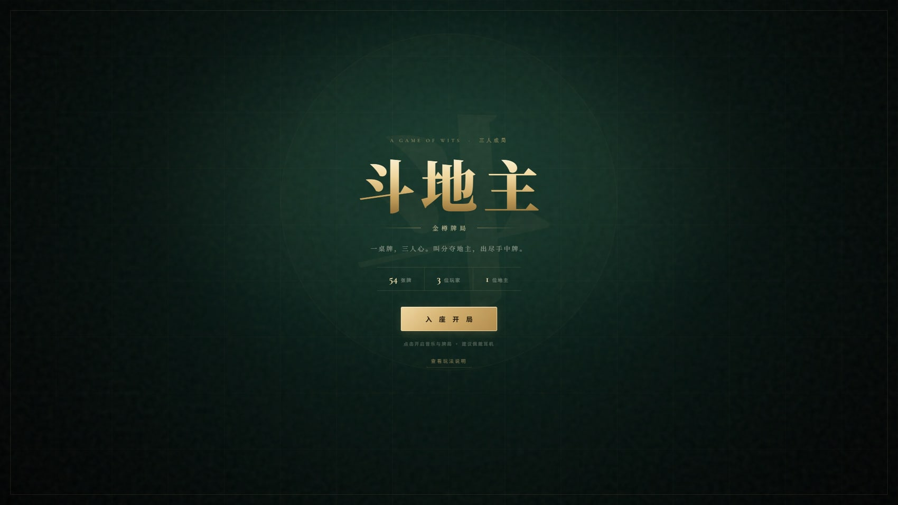
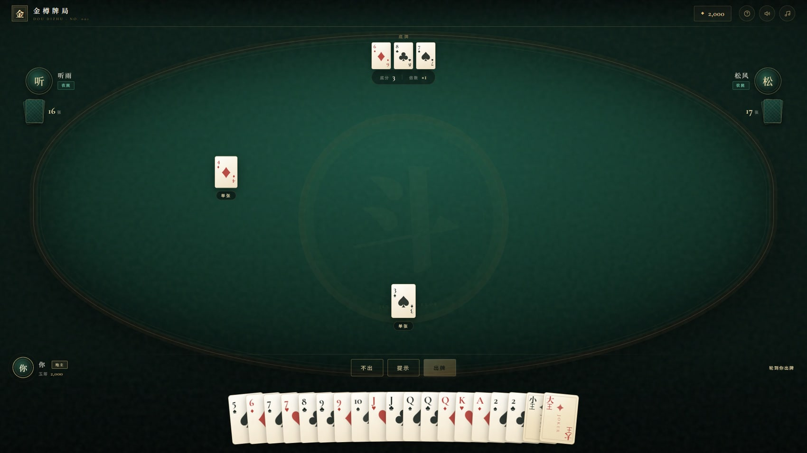
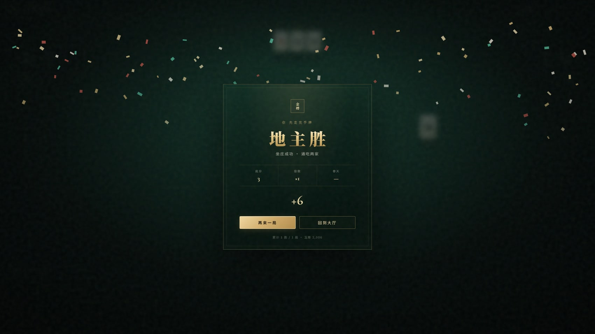
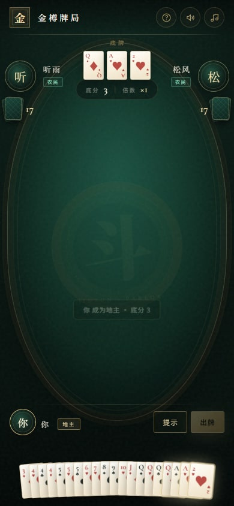

# 金樽牌局 · 斗地主

> 一桌牌，三人心。叫分夺地主，出尽手中牌。

一个纯前端、零依赖的斗地主 Demo：完整的牌型规则、两位会思考的 AI 对手、深墨绿 + 鎏金的牌桌视觉，以及完全由 Web Audio 实时合成的古风背景音乐。

**🎴 在线试玩 → [q15151512w.github.io/jinzun-doudizhu](https://q15151512w.github.io/jinzun-doudizhu/)**



## 特性

- **完整斗地主规则** —— 叫分 1/2/3、地主拿底牌；单张、对子、三张、三带一/二、顺子、连对、飞机（带单/带对）、四带二、四带两对、炸弹、王炸；春天 / 反春天与倍数翻倍。
- **两个有策略的 AI** —— 按手牌强度叫分；跟牌取最小代价、避免拆炸弹；农民之间主动让牌配合；对手逼近出完时果断用炸；领出时优先甩长牌型。
- **双引擎牌型系统** —— `analyze` 识别任意牌型，`generateMoves` 枚举手牌的所有合法组合，提示与 AI 共用同一套规则。
- **精心打磨的视觉** —— Art Deco 鎏金双线牌桌、扇形手牌、发牌 / 出牌 / 炸弹震屏 / 王炸光扫 / 胜利彩纸等一整套动效。
- **程序化音乐与音效** —— 无任何外部音频文件：D 小调五声音阶的拨弦氛围乐、延音铺底、风铃点缀，以及发牌、叫分、炸弹、胜负等 12 种音效。
- **本地存档** —— 玉筹、胜局与音效偏好通过 `localStorage` 保留。
- **响应式** —— 桌面、平板与手机均可游玩。

<table>
<tr>
<td width="50%"></td>
<td width="50%"></td>
</tr>
<tr>
<td width="50%"></td>
<td width="50%" valign="middle">
<p><b>玩法</b></p>
<p>依次叫分，最高者成为地主并获得三张底牌。地主先出牌，率先出完手牌的一方获胜。</p>
<p>点击手牌选择，点击「提示」自动选出一手可出的牌并循环切换；不能压过上家时可以选择「不出」。</p>
</td>
</tr>
</table>

## 快速开始

无需安装、无需构建：

```bash
# 方式一：直接用浏览器打开
#   Windows: start index.html
#   macOS:   open index.html

# 方式二：用任意静态服务器（推荐）
npx serve .
# 或
python -m http.server 8080
```

然后访问 `http://localhost:3000`（或对应端口）。首次点击「入座开局」后音乐才会启动，这是浏览器的自动播放策略限制；右上角可随时开关音乐与音效。

## 玩法说明

1. **叫分**：每位玩家按顺序叫 1 / 2 / 3 分或不叫，叫 3 分立即成为地主；无人叫分则重新发牌。
2. **出牌**：地主先出，之后轮流跟牌。可以出更大且同牌型同张数的牌，或用炸弹 / 王炸压制。
3. **胜负**：地主先出完，地主胜；任一农民先出完，农民胜。
4. **计分**：底分 × 倍数。炸弹 / 王炸每次翻倍；春天（农民一张牌未出）或反春天再翻倍。地主按双倍结算。

## 技术实现

| 模块 | 说明 |
| --- | --- |
| `js/cards.js` | 54 张牌与牌型引擎：多候选飞机的消歧、炸弹比较、候选出牌生成 |
| `js/ai.js` | 手牌强度评估、叫分决策、跟牌 / 领出启发式、农民协作与炸弹时机 |
| `js/audio.js` | Web Audio 前瞻调度的五声音阶生成音乐，拨弦 / 铺底 / 风铃合成，以及全部音效 |
| `js/game.js` | 状态机（叫分 → 出牌 → 结算）、渲染、动效编排、暂停与本地存档 |
| `css/style.css` | 墨绿 × 鎏金设计系统、纸牌视觉、响应式布局与关键帧动画 |

- 纯 HTML / CSS / JavaScript，**无框架、无构建步骤、无运行时依赖**。
- 音乐由振荡器 + 滤波器 + 反馈延迟实时合成，牌面与牌背由 CSS 绘制，彩纸由 DOM 粒子生成。
- 已通过 500 局 AI 自对弈校验（0 卡死、0 非法出牌）与 Playwright 全流程回归（叫分 → 出牌 → 结算 → 再来一局，含手机端布局）。

## 项目结构

```
.
├── index.html          # 页面骨架与所有界面
├── css/
│   └── style.css       # 设计系统、牌面、动画、响应式
├── js/
│   ├── cards.js        # 牌型识别 / 比较 / 候选生成
│   ├── ai.js           # AI 对手
│   ├── audio.js        # 程序化音乐与音效
│   └── game.js         # 游戏流程与 UI
├── screenshots/        # README 截图
└── README.md
```

## 说明

本项目为学习与演示用途，不涉及真实货币、充值或赌博。牌面、音效均为代码生成，可自由用于学习与二次创作。

---

Made with vanilla JS · 金樽牌局 NO. 001
